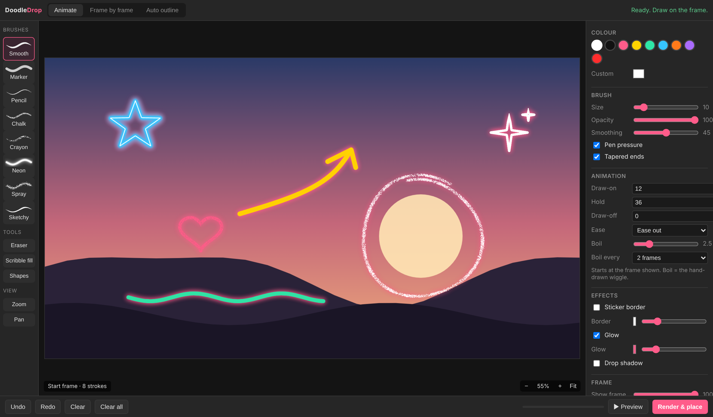

# Doodle Drop

**Draw animated, hand-drawn doodles directly inside Adobe Premiere Pro.**

Doodle Drop is a Premiere Pro panel that grabs the frame at your playhead and lets you draw straight on it with a mouse or pen tablet. When you're done, it renders a transparent PNG sequence and places it on your timeline, lined up at the right frame. You don't need to export frames or open After Effects.



## Features

### Three modes
- **Animate:** draw once and it animates for you. Set Draw-on, Hold and Draw-off lengths in frames, choose an ease, and add **Boil** (the wobbly hand-drawn wiggle) every 1-4 frames.
- **Frame by frame:** traditional animation on 1s, 2s, 3s or 4s. Prev / Next (or `,` and `.`) moves through your sequence and grabs each frame. Includes onion skin (last 1-3 drawings in red/blue), Copy previous and Start here.
- **Auto outline:** traces the strong edges in your shot into sketchy hand-drawn lines that redraw every 1-3 frames with wobble. Use **Outline area** to loop around your subject so only it gets outlined. You can tweak Detail, Simplify, Min line and the sketchy double line.

### Brushes and tools
- 8 brushes: Smooth, Marker, Pencil, Chalk, Crayon, Neon, Spray, Sketchy
- Pen pressure, tapered ends, adjustable size, opacity and smoothing
- **Eraser** (`E`)
- **Scribble fill** (`F`): draw a loop and it fills with a zig-zag scribble that animates on
- **Shapes** (`S`): drag a box to place a hand-drawn circle, arrow, star, heart, sparkle, burst, tick, cross, spiral, scribble, loops, crown, brackets, speech bubble or underline

### Length: hold, repeat, match clip
In Animate and Frame by frame mode:
- **Hold at end:** keeps the finished doodle on screen for extra frames, still wiggling (in Animate it's added to the Hold before draw-off).
- **Repeat:** plays the whole animation several times in a row.
- **Match selected clip length:** select a clip on the timeline and the render ends exactly where that clip ends. With Repeat above 1 it loops to fill the clip, otherwise it holds the end.

### Effects
Sticker border, glow and drop shadow, all baked into the render.

### Zoom and pan (built for pen tablets)
- **Zoom** (`Z`): press and drag right/up to zoom in, left/down to zoom out, around the spot you pressed. Tap zooms in 2x, `Alt` + tap zooms out.
- **Hold `Z`** on any brush to zoom temporarily, then let go and you're back on your brush. **Hold `H`**, the pen's side button or the middle mouse button to pan.
- Mouse wheel zooms at the cursor and `Shift` + wheel pans. `0` = Fit, `1` = 100%, `+` / `-` zoom.

### Clearing
- **Clear frame** (`Delete`) clears the current drawing.
- **Clear all** (`Shift` + `Delete`) clears every drawing on every frame at once.
- **Clear all drawings after Render & place** (on by default) starts you fresh after every render.
- `Ctrl+Z` / `Ctrl+Shift+Z` undo and redo everything, including Clear all.

### Render & place
Renders a transparent PNG sequence into a `Doodles` folder next to your project, imports it into a `Doodles` bin, and puts it on the first free video track above your clips at the start frame.

## Installation

### Easy install (recommended)
1. Go to **[Releases](https://github.com/codser/DoodleDrop/releases/latest)** and download `DoodleDrop-v1.1.0.zip`.
2. Close Premiere Pro and unzip the download.
3. Run the installer:
   - **Windows:** double-click `Install-Windows.bat`. If Windows shows "Windows protected your PC", click **More info → Run anyway**.
   - **Mac:** right-click `Install-Mac.command` → **Open** → **Open**.
4. Open Premiere Pro and go to **Window → Extensions → Doodle Drop**.

The installer copies the panel into Adobe's extensions folder and turns on loading of unsigned panels, which Doodle Drop needs.

### Manual install
1. Copy the `DoodleDrop` folder from the zip into your CEP extensions folder:
   - **Windows:** `C:\Users\<you>\AppData\Roaming\Adobe\CEP\extensions\`
   - **macOS:** `~/Library/Application Support/Adobe/CEP/extensions/`
2. Enable unsigned extensions (one time):
   - **Windows:** open Registry Editor, go to `HKEY_CURRENT_USER\Software\Adobe\CSXS.11` (also `CSXS.12` for newer Premiere versions) and add a String value `PlayerDebugMode` = `1`.
   - **macOS:** in Terminal run `defaults write com.adobe.CSXS.11 PlayerDebugMode 1` (repeat with `CSXS.12`).
3. Restart Premiere Pro and open **Window → Extensions → Doodle Drop**.

Requires Premiere Pro 2020 (v14) or newer. If the panel doesn't show up, repeat step 2 with `CSXS.13`.

## Keyboard shortcuts

| Key | Action |
| --- | --- |
| `B` / `E` / `F` / `S` | Brush / Eraser / Scribble fill / Shapes |
| `Z` / `H` | Zoom / Pan (hold for temporary) |
| `0` / `1` / `+` / `-` | Fit / 100% / Zoom in / Zoom out |
| `[` / `]` | Brush size down / up |
| `,` / `.` | Previous / next drawing (Frame by frame) |
| `Space` | Preview animation |
| `Delete` / `Shift+Delete` | Clear frame / Clear all |
| `Ctrl+Z` / `Ctrl+Shift+Z` | Undo / Redo |

## Project structure

```
CSXS/manifest.xml   Extension manifest
index.html          Panel UI
css/style.css       Panel styles
js/app.js           Panel logic (drawing, modes, zoom, render)
js/brushes.js       Brush engine, effects, edge tracing
js/shapes.js        Hand-drawn shape library
jsx/host.jsx        Premiere Pro ExtendScript (frame grab, import, placement)
install/            One-click installers for Windows and Mac + install guide
```

## Feedback

Issues and feature requests are welcome. Open an issue if something breaks or there's a brush or shape you'd like added.
